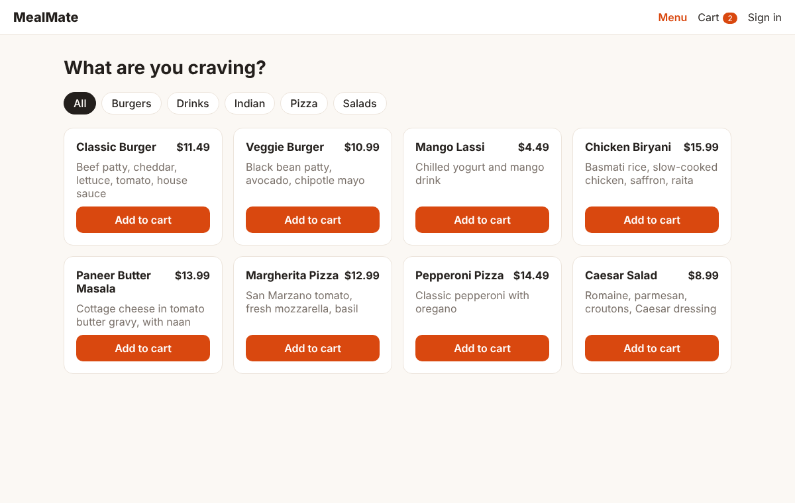

# MealMate — Food Ordering & Payment Processing

A full-stack food ordering platform: browse a menu, build a cart, place an order and pay with **Stripe**. Customers track their orders; admins run a kitchen dashboard and manage the menu.




## Features

- **JWT authentication** with BCrypt-hashed passwords and stateless sessions
- **Role-based access control:** `CUSTOMER` and `ADMIN`. Menu writes and the kitchen dashboard are admin-only; customers can only see their own orders.
- **Server-side pricing:** the client sends only item ids and quantities. Totals are computed from the database, so prices can't be tampered with.
- **Stripe payments:** a PaymentIntent is created per order with an idempotency key, so retries never double-charge. Orders become `PAID` only through a **signature-verified webhook**, never on the client's word. Replayed webhooks are harmless.
- **Order lifecycle** enforced as a state machine: `PENDING_PAYMENT → PAID → PREPARING → OUT_FOR_DELIVERY → DELIVERED`, or `CANCELLED`.
- **Price snapshots:** order lines store the price at order time, so menu edits don't rewrite history.
- Validation and consistent JSON error responses, optimistic locking on orders, integration tests with MockMvc.

## How it works

```
React (Vite) ──JWT──▶ Spring Boot REST API ──JPA──▶ MySQL
     │                        │
     │  Stripe Elements       │  PaymentIntent (idempotent)
     └────────▶ Stripe ◀──────┘
                  │
                  └── webhook (signature verified) ──▶ order marked PAID
```

The React front end talks to a stateless Spring Boot REST API using a JWT on each request. Orders are priced on the server from the database. Checkout creates a Stripe PaymentIntent with an idempotency key, and the order only becomes `PAID` when Stripe's signed webhook arrives. The payment provider sits behind a `PaymentGateway` interface, so tests replace Stripe with a mock.

## Run it

**Option 1: quickest (no MySQL, no Stripe)**

```bash
# Backend with in-memory H2 database
cd backend
SPRING_PROFILES_ACTIVE=dev mvn spring-boot:run

# Frontend (new terminal)
cd frontend
npm install
npm run dev
```

Open http://localhost:5173. A sample menu is seeded automatically. Sign in as admin with `admin@mealmate.dev` / `admin12345` (dev profile only), or register as a customer.

Without Stripe keys you can browse, order and manage orders; the checkout page will say payments aren't configured.

**Option 2: full stack with Docker**

```bash
cp .env.example .env    # fill in JWT_SECRET, ADMIN_PASSWORD and Stripe test keys
docker compose up --build
```

Open http://localhost:3000.

**Enabling payments locally**

1. Get test keys from the [Stripe dashboard](https://dashboard.stripe.com/test/apikeys).
2. Set `STRIPE_SECRET_KEY` for the backend and `VITE_STRIPE_PUBLISHABLE_KEY` in `frontend/.env`.
3. Forward webhooks with the [Stripe CLI](https://docs.stripe.com/stripe-cli):
   ```bash
   stripe listen --forward-to localhost:8080/api/payments/webhook
   ```
   Put the printed `whsec_...` value in `STRIPE_WEBHOOK_SECRET`.
4. Pay with test card `4242 4242 4242 4242`, any future date, any CVC.

**API**

| Method | Endpoint | Access | Description |
|---|---|---|---|
| POST | `/api/auth/register` | public | Create a customer account, returns JWT |
| POST | `/api/auth/login` | public | Log in, returns JWT |
| GET | `/api/menu?category=` | public | List available menu items |
| POST / PUT / DELETE | `/api/menu/{id}` | admin | Manage the menu (delete archives the item) |
| POST | `/api/orders` | customer | Place an order `{deliveryAddress, items:[{menuItemId, quantity}]}` |
| GET | `/api/orders` | customer | My orders |
| GET | `/api/orders/{id}` | owner / admin | Order details |
| POST | `/api/orders/{id}/checkout` | owner | Create Stripe PaymentIntent, returns `clientSecret` |
| POST | `/api/orders/{id}/cancel` | owner | Cancel an unpaid order |
| GET | `/api/admin/orders` | admin | All orders |
| PATCH | `/api/admin/orders/{id}/status` | admin | Advance order status |
| POST | `/api/payments/webhook` | Stripe | Payment events (signature verified) |

## Tests

```bash
cd backend
mvn test
```

9 integration tests run the real Spring Boot app against an in-memory H2 database with Stripe mocked. They cover sign-up and login, role checks, customers only seeing their own orders, server-side totals, checkout, signed and replayed webhooks, and order status rules. GitHub Actions runs them plus a production build of the front end on every push.

## Project structure

| Folder | Description |
|---|---|
| `backend/.../controller/` | REST endpoints |
| `backend/.../service/` | Business logic for auth, menu and orders |
| `backend/.../payment/` | `PaymentGateway` interface and the Stripe implementation |
| `backend/.../security/` | JWT issuing and checking, request filter, security config |
| `backend/.../model/`, `repository/`, `dto/` | JPA entities, Spring Data repositories, request and response records |
| `backend/src/test/` | Integration tests |
| `frontend/src/pages/` | Menu, cart, sign-in, orders, checkout and admin pages |
| `frontend/src/state.jsx`, `api.js` | Session and cart state, and the fetch wrapper that attaches the JWT |
| `docs/` | Screenshots |

`backend/...` is short for `backend/src/main/java/com/ramya/mealmate`.
